# Environments and promotion

## Architecture

Each Render Docker web service serves the React frontend and FastAPI API from
one origin. They use separate PostgreSQL databases; accounts and saved looks
are not shared. Uploaded originals remain in memory.

| Role | Service / public URL | Database | Deployment |
| --- | --- | --- | --- |
| Dev | [gradematch-web](https://gradematch-web.onrender.com) | Existing Render `gradematch-db` | `main`, after CI checks pass |
| Production | [gradematch-prod](https://gradematch-prod.onrender.com) | Separate Neon PostgreSQL | Manual confirmed promotion, auto-deploy off |

Both services use the root Dockerfile, Free compute and Frankfurt in
[render.yaml](../render.yaml). Dev retains its original public URL. The owner
reports both live environments verified; the evidence below distinguishes
recorded observations from checks still lacking durable evidence.

## Environment and database setup (#137)

`gradematch-web` remains dev: its resource name, Docker configuration and
`gradematch-db` binding are preserved. `gradematch-prod` is a separate free
Frankfurt Docker service with automatic deployment disabled. Supply its
`DATABASE_URL` securely through Render using a **separate Neon PostgreSQL
database**. Never copy dev's connection string. The unchanged entrypoint waits
for the database and runs Alembic before serving requests.

Render allows [one active free PostgreSQL database per workspace](https://render.com/docs/free),
so prod uses Neon. Render's free database expires after 30 days; the actual dev
database dashboard notice states **December 3, 2026 (2026-12-03)**; see the
owner screenshot below. Free web instances sleep after 15 idle minutes; review the
linked current limits before relying on this environment.

For an existing Blueprint, `sync: false` does **not** apply a new secret on
updates: manually enter prod's secret in its Environment page before deploying.
On first Blueprint creation Render prompts for it. See the
[environment-variable specification](https://render.com/docs/blueprint-spec#environment-variables).

Before sync, record dev's actual service ID, URL and database identity. Review
Blueprint changes to confirm the existing resources are retained, only prod is
added, and no database is replaced. After sync record both identities, actual
URLs, plans, regions, deploy SHAs/events and successful migrations. The actual public URLs are listed above, corroborated by the successful
promotion summary. Dev service ID is `srv-dbkf7pl6e07s73c9u6n0` (settings
screenshot); prod is `srv-dbson2jrjlhs739tg6ug` (independent #139 QA). A before/after
identity comparison still requires its historical record.
Verify `/`, `/login`, `/docs` each return 200 on both actual URLs after wake-up.

Use two distinct disposable accounts: register on dev only, verify successful
dev login and prod authentication error without registration; repeat in reverse.
Save a synthetic look in each and verify it is absent from the other Library.
Record sanitized statuses and look identifiers; omit credentials, emails,
connection strings and tokens. The owner-supplied one-way check is recorded below; the reciprocal account
and both saved-look checks remain unverified.

## Complete Blueprint field audit

Checked **2026-11-15 (Asia/Almaty)** against the requested
[YAML specification](https://render.com/docs/yaml-spec), its current
[Blueprint reference](https://render.com/docs/blueprint-spec), and the official
[JSON Schema](https://render.com/schema/render.yaml.json). Each row covers every
occurrence of that path in the complete file. Links identify the relevant
specification section.

| Field | Value | Purpose / specification |
| --- | --- | --- |
| `services` | two entries | [Non-Postgres services](https://render.com/docs/blueprint-spec#root-level-fields) |
| `services[].type` | `web` both | [HTTP services](https://render.com/docs/blueprint-spec#service-fields) |
| `services[].name` | `gradematch-web`, `gradematch-prod` | Stable service identities, same reference |
| `services[].runtime` | `docker` both | Existing image build, same reference |
| `services[].dockerfilePath` | `./Dockerfile` both | Repository Dockerfile, same reference |
| `services[].dockerContext` | `.` both | Root build context, same reference |
| `services[].plan` | `free` both | Free compute, same reference |
| `services[].region` | `frankfurt` both | Frankfurt deployment, same reference |
| `services[].healthCheckPath` | `/docs` both | Existing HTTP health path, same reference |
| `services[0].autoDeployTrigger` | `checksPass` | Dev waits for CI; [service fields](https://render.com/docs/blueprint-spec#service-fields) |
| `services[1].autoDeployTrigger` | quoted `off` | Manual prod deployment; same reference. Quotes preserve the string under YAML 1.1 validators. |
| `services[].envVars` | lists | [Environment entries](https://render.com/docs/blueprint-spec#environment-variables) |
| `services[].envVars[].key` | `DATABASE_URL`, `DEPLOYMENT_ENVIRONMENT` | Backend configuration keys, same reference |
| dev `DATABASE_URL.fromDatabase` | object | Managed database binding, same reference |
| `fromDatabase.name` | `gradematch-db` | Preserves dev database, same reference |
| `fromDatabase.property` | `connectionString` | Supported private URL property, same reference |
| prod `DATABASE_URL.sync` | `false` | Secure manual secret entry, same reference |
| `DEPLOYMENT_ENVIRONMENT.value` | `dev`, `prod` | Distinct telemetry environments, same reference |
| `databases` | one entry | [Postgres resources](https://render.com/docs/blueprint-spec#postgres-fields) |
| `databases[].name` | `gradematch-db` | Existing database identity, same reference |
| `databases[].plan` | `free` | Existing free instance, same reference |
| `databases[].region` | `frankfurt` | Existing database region, same reference |

Official schema downloaded 2026-11-15; SHA-256
`6c6721a602ef6d368d5c9384c473cefaae99980e43dd4b1adcf8a2f258fc54f4`.
Validation used existing backend development dependencies PyYAML 6.0.3 and
jsonschema 4.26.0, `validator_for(schema).check_schema(schema)` then
`validator(schema).validate(yaml.safe_load(Path('../render.yaml').read_text()))`.
Output: `PASS render.yaml: official Render JSON Schema`.
This validates structure, not dashboard settings or successful deployment.

Reproduce from the repository root using existing backend development dependencies:

```sh
curl -fsSL https://render.com/schema/render.yaml.json -o /tmp/gradematch-render-schema.json
cd backend
uv run python - <<'PYTHON'
import json
from pathlib import Path
import jsonschema
import yaml
schema = json.loads(Path('/tmp/gradematch-render-schema.json').read_text())
validator = jsonschema.validators.validator_for(schema)
validator.check_schema(schema)
validator(schema).validate(yaml.safe_load(Path('../render.yaml').read_text()))
print('PASS render.yaml: official Render JSON Schema')
PYTHON
```


## Automatic dev CI gate (#138)

Dev uses `autoDeployTrigger: checksPass`; prod remains `off`. The existing
`CI` workflow runs independent `backend` and `frontend` jobs, then dependent
`stack`. Backend runs the full pytest suite; frontend runs TypeScript, tests and
build; stack runs `make integration` and `make e2e`. No job or assertion changed.

[Render CI integration](https://render.com/docs/deploys#integrating-with-ci)
waits for checks on the exact new commit. GitHub conclusions `success`, `neutral`
and `skipped` count as passed; zero checks or a failed check blocks automatic
deployment. Keep all three jobs enabled. Privileged manual deploys and hooks
are separate from this automatic gate. The promotion workflow's independent
CI validation is implemented by the [promotion workflow](../.github/workflows/promote-production.yml),
described below.

The complete field audit above and official schema validation were repeated on
2026-11-15 after adding `checksPass`: `PASS render.yaml: official Render JSON Schema`
(same schema SHA-256 and validator versions).

The supplied settings screenshot shows “After CI Checks Pass” for dev.
Still needed for the full gate experiment: successful commit SHA, CI run URL/conclusion and completion time,
then Render event for that same SHA with timezone; endpoint HTTP 200 results.
For an owner-controlled failed/pending/recovery experiment, retain the prior
live SHA, failed SHA/run, terminal completion time and observation interval,
Render event history showing no deploy for failed/pending SHA, then recovery
CI completion and subsequent matching deploy event. The owner explicitly authorized a controlled temporary failing assertion on
`main`, observing pending and failed CI with no Render deployment, then reverting
that assertion and verifying successful recovery. Preserve all existing assertions
and always recover `main`. Establish usable Render read access before pushing
the temporary failure so the gate can actually be observed. A green GitHub run alone does not
prove the deployment gate or live service identity.

## Telemetry identity and repeatable local demo (#140)

Render's [actual deployment commit](https://render.com/docs/environment-variables#render_git_commit)
`RENDER_GIT_COMMIT` takes precedence over build defaults: startup exports its first
seven characters as `APP_VERSION`, and telemetry resource/business identity uses
the same resolution. Thus manually deploying an older SHA identifies that older
SHA. Explicit local `APP_VERSION` remains supported; telemetry stays opt-in via
`OTEL_EXPORTER_OTLP_ENDPOINT`. Resources expose `deployment.environment` and
`service.version`; business instruments expose matching `environment`/`version`.
Cloud request log/trace/metric identity versus actual deployment metadata remains
waiting for owner evidence on both services.

Prerequisites: Docker Desktop/Engine with Compose v2 supporting `--wait`, Python
3 standard library, Git, available image registry access, and this checkout with
its existing JPEG fixture. No cloud credentials or additional packages required.
From repository root:

```sh
make obs-demo
# Optional distinct seven-character lowercase hex commit overrides:
DEMO_DEV_VERSION=4717cb7 DEMO_PROD_VERSION=a3ce833 make obs-demo
make obs-demo-down
```

Defaults derive dev from `git rev-parse --short=7 HEAD` and prod from `HEAD^`.
Overrides identify the supplied demonstration versions; both containers run the
current working-tree image, not separate historical builds. Dev uses
`http://localhost:18091`, prod `http://localhost:18092`, Grafana
`http://localhost:13000` (local-only demo login `admin` / `admin`). Prometheus is
`:19090`, Loki `:13100`, Tempo `:13200`, Collector OTLP `:14318`, Collector health
`:13134`; every published port binds loopback. Internal app ports are both 8091.

The fixed project `gradematch-obs-demo` owns its network, containers and named
observability volumes. Each app has an independent SQLite database in its own
container `/tmp/demo.db`; recreation resets only that app's synthetic accounts.
No uploaded image is stored. Cleanup removes only this project's containers,
network and volumes, preserving normal app/integration/E2E and observability
projects and all cloud services. The demo overrides inherited Compose project
and OTLP binding settings. A second invocation reuses resources safely, waits
for readiness and sends new synthetic traffic. Shutdown is explicit even after
a failed run (`make obs-demo-down`).

The sample sends register, generate, save-look, render-LUT and rejected missing
upload actions from each app twice, separated by scrapes. Credentials remain in
memory. It asserts all six real dashboard queries are populated, metrics carry
matching resource/business identity, Loki request logs correlate to Tempo traces,
and exact dev/prod/both environment/version selections return the intended
nonempty series. Grafana's Environment and Version filters support multiple
values and All; version options follow selected environments using regex
selectors. The script prints URLs and writes sanitized query evidence to
`/tmp/gradematch-obs-demo-evidence.json` (override `DEMO_EVIDENCE_PATH`).

See [observability runbook](observability.md). Saved local evidence is in
`docs/img/obs-demo-evidence.json` and `obs-demo-dev.png`, `obs-demo-prod.png`,
`obs-demo-both.png`. These demonstrate local synthetic instances, not a cloud
deployment or production promotion.

## Local implementation verification (2026-11-15)

- Backend `UV_CACHE_DIR=/tmp/gradematch-uv-cache uv run pytest`: **224 passed,
  1 skipped** (opt-in PostgreSQL journey); includes actual older Render SHA
  precedence and local explicit-version regressions.
- Frontend `npm test -- --run`: **52 passed**, 12 files.
- `make integration`: **10 passed**, unchanged scenarios/assertions.
- `make e2e`: **PASS** guest, Library and Studio session scenarios plus **30
  Playwright tests** (1.2m), unchanged assertions. Existing preview timing
  observations above the product target remain reported by the suite.
- `make obs-demo`: PASS at 10:34:46 UTC; second invocation PASS at
  10:36:12 UTC. Supplied/default identities were dev `4717cb7`, prod `a3ce833`.
  Actual metrics, correlated request logs/traces and dev/prod/both filters are
  recorded in `docs/img/obs-demo-evidence.json`; populated Grafana screenshots
  show each selection. No cloud identity is claimed by these local results.
- `make obs-demo-down`: all demo containers and named volumes removed. Normal
  Compose container IDs before/after were identical; its `/docs` returned 200
  while the unchanged E2E suite continued running.
- `git diff -- openapi.yaml`: empty. No dependency added or assertion weakened.

These results apply to implementation commit
[`85c7655c25335235844cb0aa7e202b9a0d69affa`](https://github.com/bakhytuly07-source/gradematch/commit/85c7655c25335235844cb0aa7e202b9a0d69affa).
[Independent QA](https://github.com/bakhytuly07-source/gradematch/issues/140#issuecomment-6893145350)
repeated backend/frontend/integration/E2E with the same totals. This docs-only
follow-up reuses those exact results; it does not claim a new suite run.
Remaining cloud evidence is itemized below; owner verification is not silently
substituted for missing per-criterion artifacts.

## Manual production promotion (#139)

`.github/workflows/promote-production.yml` is dispatch-only. Use the GitHub
`production` environment. Final #139 QA found it exists with no reviewer or
branch protection rules. Operators can add required reviewers and a `main`
deployment-branch restriction under Settings → Environments → production;
these protections are recommendations, not observed current settings. Its job grants only `actions: read` (exact-SHA CI inspection)
and `contents: write` (atomic release tag creation). The single job concurrency
group `production-promotion`, with cancellation disabled, serializes production
promotions. GitHub allows one running and one pending job per group; a newer
pending job can replace an older pending job, but does not cancel the running
promotion. Dispatch confirmations on `main` only; the runner is checked out from
`main` and the deployed commit is independently frozen from Render dev metadata.

Required secrets (repository or `production` environment): `RENDER_API_KEY`,
`RENDER_DEV_SERVICE_ID`, `RENDER_PROD_DEPLOY_HOOK_URL`. The API key needs read
access to deploy metadata for both services. Set repository/environment variables
`DEV_URL=https://gradematch-web.onrender.com`,
`PROD_URL=https://gradematch-prod.onrender.com`, and `RENDER_PROD_SERVICE_ID` to the
actual non-secret Render `srv-…` production service ID. Verify the actual URLs
and ID against Render before enabling promotion. The production service ID was initially missing;
[final QA](https://github.com/bakhytuly07-source/gradematch/issues/139#issuecomment-6893816989)
verified it was configured as `srv-dbson2jrjlhs739tg6ug`.
No service identity is inferred from its name. Missing configuration fails
before the hook. The hook URL must target `https://api.render.com` with its
existing authentication query and no preconfigured `ref`.

The standard-library runner reads Render's official
[deployment-list response](https://api-docs.render.com/reference/list-deploys)
(`deployWithCursor` array, `deploy.commit.id`, `deploy.status`; pagination is
followed). Exactly one `live` dev deployment is required. Newer queued/building
or failed entries cannot replace it. CI is read by full SHA from `ci.yml`, with
the latest updated run/attempt required successful, including all three jobs.
Dev `/docs` must return the Swagger application before deploying. Public HTTP
requests refuse redirects; wake-up retries are bounded to two minutes for dev.

The [documented hook behavior](https://render.com/docs/deploy-hooks) preserves
existing query parameters and appends URL-encoded `ref=<full SHA>`. HTTP 200
supplies `deploy.id`; HTTP 202 requires discovery of a new matching hook deploy,
excluding all pre-hook deploy IDs. Metadata must identify the frozen SHA as live,
then the actual prod Swagger `/docs` must be healthy, within 600 seconds measured
from hook invocation, including hook time. Per-request timeouts never exceed
the remaining deadline. No previous healthy deployment can satisfy this gate.
Smoke requests then require `/`, `/login`, `/docs` 200 and `/api/auth/me` 401 with
the existing JSON error shape. Only then an atomic GitHub ref creation publishes
`prod-YYYYMMDD-HHMMSS-<first seven SHA characters>` in UTC. Existing refs fail;
tags are never overwritten. No tag is created on earlier failures.

A false confirmation exits with zero metadata/deployment calls and no tag.
Summaries report outcome, full SHA, public URLs, UTC timestamps, elapsed time,
note, CI URL, deployment ID, hook-call count and successful tag. Untrusted note
characters are numeric HTML entities, preventing Markdown/HTML/mention execution;
secrets and raw HTTP error bodies are suppressed. A failure after the hook can
leave the new production deployment live; the workflow does not roll back.

Isolated checks: `python3 -m unittest discover -s scripts/tests -v`. They cover
false confirmation, missing/pending/failed CI, unhealthy dev, hook HTTP error,
wrong prod SHA, the simulated full 600-second deadline, queued-deploy matching,
smoke failure, frozen SHA/query preservation and untrusted summary text. Real rejected/successful dispatch, release tag and concurrent-confirmation
evidence was subsequently verified by #139 QA (linked below). The Engineer
implementation checks did not invoke the live hook.

Implementation verification on 2026-11-15: promotion isolated checks **7 passed**;
workflow parsed with existing PyYAML and dispatch/input/permission/concurrency
invariants passed; backend **224 passed, 1 opt-in PostgreSQL test skipped**;
frontend **52 passed**; `make integration` **10 passed**; `make e2e` guest,
Library and Studio-session scenarios plus **30 Playwright tests passed** (1.1m).
Backend required sandbox escalation for its loopback OTLP receiver; Docker
checks required local Docker socket access. Existing product preview timings
above 300ms remain visible in the unchanged E2E suite. `openapi.yaml` is unchanged,
no dependency was added, and no existing CI/test assertion was changed. Subsequent live-promotion QA is recorded below.

QA correction (2026-11-15): urllib raises `HTTPError` for the expected auth 401.
The promotion transport must retain its JSON body for smoke contract validation,
rather than replacing every error response body with empty bytes. Error bodies
are now read only into memory with a 1 MiB limit and never logged. A regression
uses a real loopback HTTP server and the real urllib transport: valid 401 JSON
passes all smoke checks; an empty error message fails. All **8 isolated promotion
tests passed** after this correction. Earlier live attempts reached production
but failed this smoke check and created no tag; they are not successful releases.
The application/OpenAPI and existing CI workflow are unchanged by the fix.

Promotion summary evidence: the runner copies its own `GITHUB_STEP_SUMMARY` file
byte-for-byte to `$RUNNER_TEMP/promotion-summary.md` immediately after writing
its sanitized summary, on success or handled failure. An `always()` artifact
step uploads only that explicit file as
`promotion-summary-<run ID>-<attempt>` with 30-day retention. This supports
independent verification when GitHub's summary viewer is inaccessible. It does
not upload environment variables, response bodies or the working directory;
it preserves the promotion step's failure status. An unavailable summary is
reported as a missing artifact, never as successful verification. The summary
regression checks byte equality between the written summary and artifact file.


## Operator steps and troubleshooting

1. Review [render.yaml](../render.yaml), the field audit above and Render's
   Blueprint changes. Preserve existing dev and database identities. Create a
   separate Neon PostgreSQL database for prod, then supply its connection URL
   privately in Render → gradematch-prod → Environment → `DATABASE_URL`.
   On an existing Blueprint, enter it manually; `sync: false` does not update it.
   Keep Docker Command unset so the existing database readiness/migration
   entrypoint runs. Verify migration completion in sanitized runtime logs.
2. In GitHub → Settings → Secrets and variables → Actions (or the production
   environment), enter the three secrets named above. Enter `DEV_URL`,
   `PROD_URL`, `RENDER_PROD_SERVICE_ID` as variables. Obtain API keys from Render
   account settings and service IDs from the actual service pages. Obtain the
   production deploy hook from prod Settings; never paste it into a command,
   issue, screenshot or repository. Rotate by creating/replacing the Render API
   key or regenerating the prod hook and immediately replacing the corresponding
   GitHub secret; revoke the old credential. Update private Neon credentials in
   Render when rotating them, then redeploy and verify migrations/health.
3. Wait for dev's exact commit `CI` backend/frontend/stack checks and Render
   deployment to complete. Inspect the current live dev deployment SHA and
   `/docs`; a green main checkout does not identify the running dev version.
4. Open [Promote production](https://github.com/bakhytuly07-source/gradematch/actions/workflows/promote-production.yml),
   choose Run workflow on `main`, check the required `confirm` boolean and
   optionally enter a note. Leaving confirmation false deliberately rejects the
   request without metadata/deployment calls. No push, PR or schedule promotes.
5. Inspect the job summary, matching Render prod deploy, four smoke statuses and
   release tag. The tag targets the frozen live dev SHA, which can be older than
   main. A success tag is created only after all gates pass. The 600-second
   production verification budget begins at the hook invocation; the workflow's
   outer job timeout is 20 minutes. Use the retained summary artifact if the
   summary viewer is unavailable (30-day retention).

Missing configuration, absent/ambiguous live dev metadata, non-successful latest
exact-SHA CI or unhealthy dev fail before deployment. A hook error, wrong live
prod SHA, verification timeout, smoke-contract error or tag collision fails the
run without a success tag. After any failure, first open prod's Render Deploys
page, inspect the live commit and compare it with the frozen SHA in the summary;
then check deploy/runtime logs and `/docs`. A post-hook failure can leave the new
version live. There is no automatic rollback. Resolve the reported cause before
running a fresh confirmed promotion; inspect its newly frozen SHA again.

If `/docs` initially fails, allow the free instance about a minute to wake and
retry within the documented health budget. A readiness/migration error needs
Render runtime-log inspection and correct private database configuration. For
empty Grafana panels rerun `make obs-demo`, select Last 5 minutes, refresh, and
select the matching Environment/Version pair; use the emitted evidence JSON to
separate missing traffic from filter errors. If ports are occupied, stop only
the conflicting local demo with `make obs-demo-down` before retrying.

### Build once limitation (post-MVP)

Promotion pins source with `ref=<full SHA>`. Render rebuilds the repository's
Dockerfile for production; it does not reuse dev's exact built image digest.
The current workflow has no image-registry publish/pull step. “Build once,
promote the same immutable image” therefore remains a post-MVP registry-based
change, not a guarantee of this workflow. The local two-instance demo likewise
labels current-working-tree builds with supplied versions.

## Observed deployment and promotion evidence

Reviewed 2026-11-15 (Asia/Almaty, UTC+05:00). Owner supplied the six cloud
screenshots below and reports live dev/prod verified. Images are readable and
contain no visible hook URL, connection string, token or private account email;
the Render deploy hook is masked. The screenshots do not display capture times;
relative “minutes ago” text is not an absolute timestamp.

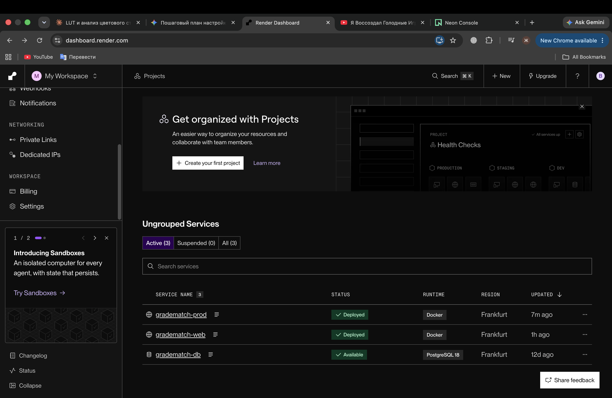

Both `gradematch-prod` and `gradematch-web` show Deployed / Docker / Frankfurt;
`gradematch-db` shows Available / PostgreSQL 18 / Frankfurt. This overview does
not itself show compute plans, secret database binding or migration logs.

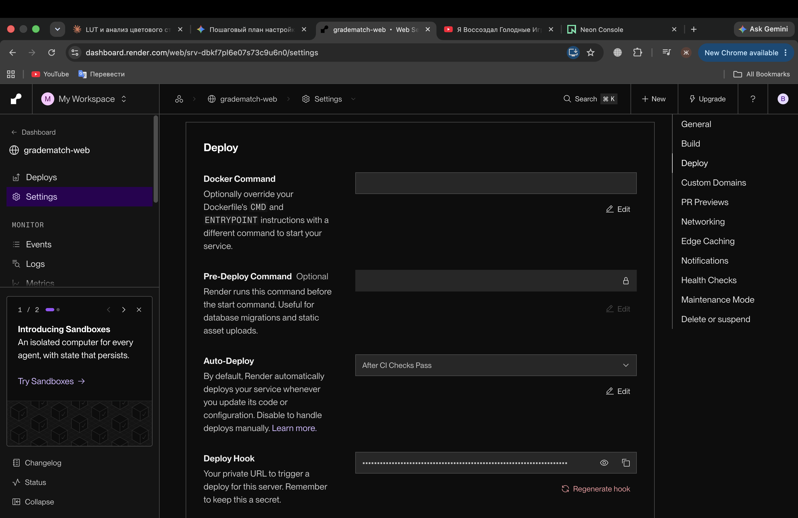

Dev's settings show “After CI Checks Pass” and its service ID in the address
bar. This proves the setting, not the controlled failed/pending/recovery deploy
experiment or a timestamped successful CI-to-Render event sequence.

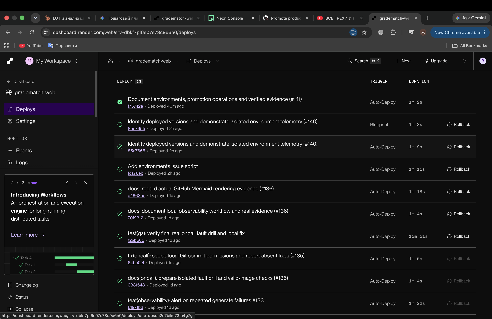

Dev service `srv-dbkf7pl6e07s73c9u6n0` shows successful Auto-Deploy of
`f75742a` (duration 1m 2s), plus successful `85c7655` Auto-Deploy and Blueprint
entries. This corroborates deployed commits on the retained service. Its
relative “40m ago” / “2h ago” labels do not establish absolute deployment times
or ordering against exact-SHA CI completion; failed/pending/recovery evidence
remains absent.

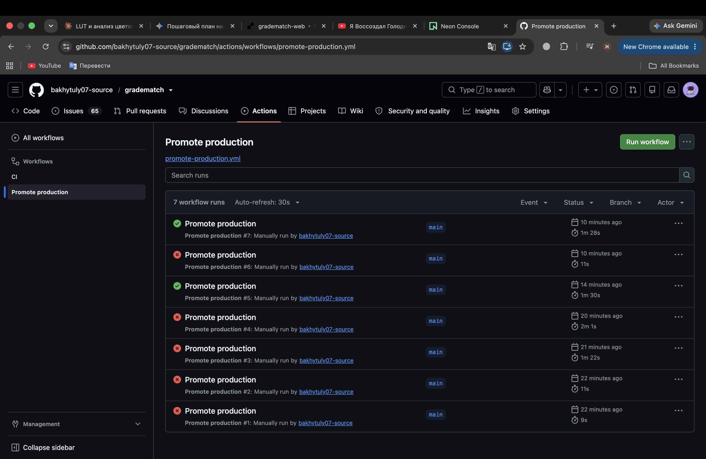

The workflow history shows successful and failed manual runs on main. A red
status alone does not prove `confirm=false`; use the linked rejection below.

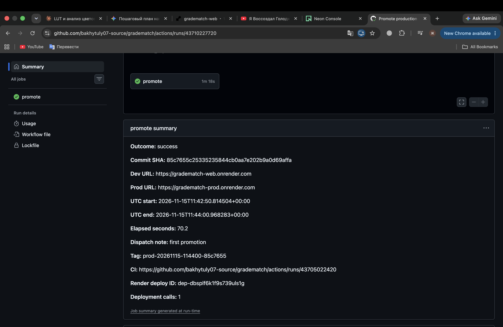

[Successful run 43710227720](https://github.com/bakhytuly07-source/gradematch/actions/runs/43710227720)
shows full frozen SHA `85c7655c25335235844cb0aa7e202b9a0d69affa`, both actual
public URLs, UTC start `2026-11-15T11:42:50.814504+00:00`, end
`2026-11-15T11:44:00.968283+00:00`, 70.2-second measured promotion time,
[exact-SHA CI 43705022420](https://github.com/bakhytuly07-source/gradematch/actions/runs/43705022420),
Render deploy `dep-dbsplf6k1f9s739uls1g`, and one deployment call.
[Release tag prod-20261115-114400-85c7655](https://github.com/bakhytuly07-source/gradematch/releases/tag/prod-20261115-114400-85c7655)
targets that full SHA, independently checked by
[final #139 QA](https://github.com/bakhytuly07-source/gradematch/issues/139#issuecomment-6893816989).
That QA record also verifies `/`, `/login`, `/docs` = 200 and unauthenticated
`/api/auth/me` = 401 with the expected JSON error. These smoke statuses are
reported from QA; they are not visible in the summary screenshot.

[Rejected confirm=false run 43710223977](https://github.com/bakhytuly07-source/gradematch/actions/runs/43710223977)
had zero deployment calls and empty SHA/tag, verified by QA from its exact
submitted summary artifact. The dedicated owner screenshot now corroborates that artifact:

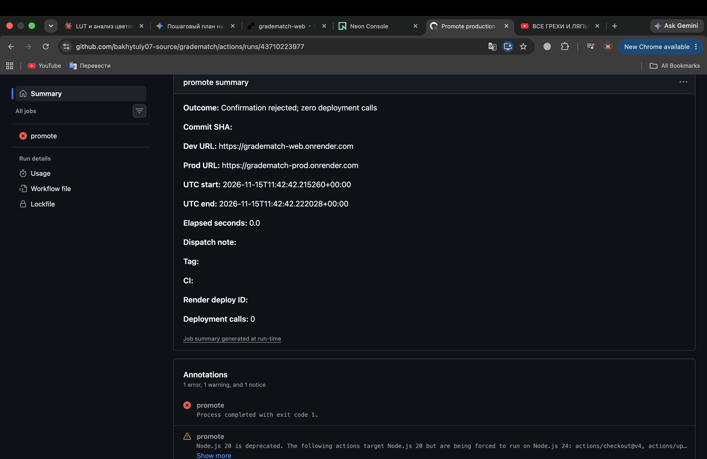

It shows “Confirmation rejected; zero deployment calls”, empty commit SHA/tag,
and UTC start `2026-11-15T11:42:42.215260+00:00`, end
`2026-11-15T11:42:42.222028+00:00`. No hook, token, connection string or private
account email is visible in either new screenshot. Historical concurrent confirmed runs
[43709381466](https://github.com/bakhytuly07-source/gradematch/actions/runs/43709381466)
and [43709425539](https://github.com/bakhytuly07-source/gradematch/actions/runs/43709425539)
showed serialization: first ended 11:33:24 UTC, second started 11:33:25 UTC on
2026-11-15. Both failed the subsequently corrected auth-smoke transport bug;
they demonstrate queue behavior, not successful releases.

### Live `/api/health` observation

Engineer read-only requests on 2026-11-15 returned the following results
(times are the HTTP response `Date` header, UTC):

| URL | Observed time | HTTP | JSON body |
| --- | --- | --- | --- |
| [Dev health](https://gradematch-web.onrender.com/api/health) | 12:58:08 UTC | 404 | `{"code":"not_found","message":"Not Found"}` |
| [Prod health](https://gradematch-prod.onrender.com/api/health) | 12:58:20 UTC | 404 | `{"code":"not_found","message":"Not Found"}` |

Neither response provides environment, version or deployed commit metadata.
These requests do not validate deployed telemetry identity or migrations, and
`/api/health` is not substituted for the documented `/docs` readiness check.
No application or API-contract change was made for this docs-only follow-up.

### Owner-supplied account isolation check

The owner reports a disposable account registered **only on dev** on 2026-11-15:
`POST /api/auth/register` on dev returned **200**, dev
`POST /api/auth/login` returned **200**, and prod `POST /api/auth/login` with
the same credentials returned **401**. The returned dev user identifier was
`a0691d36-d5fa-4552-ba45-5460415e17e3`. Email, password and tokens are omitted.
This is owner-supplied evidence, not an independently replayed request; no exact
request timestamp or sanitized error body was supplied. It supports one-way
dev-to-prod account isolation. The reverse prod-only registration/login check
and saved-look absence in both Libraries have not been supplied, so complete
database/Library isolation is still unverified.

### Local telemetry evidence

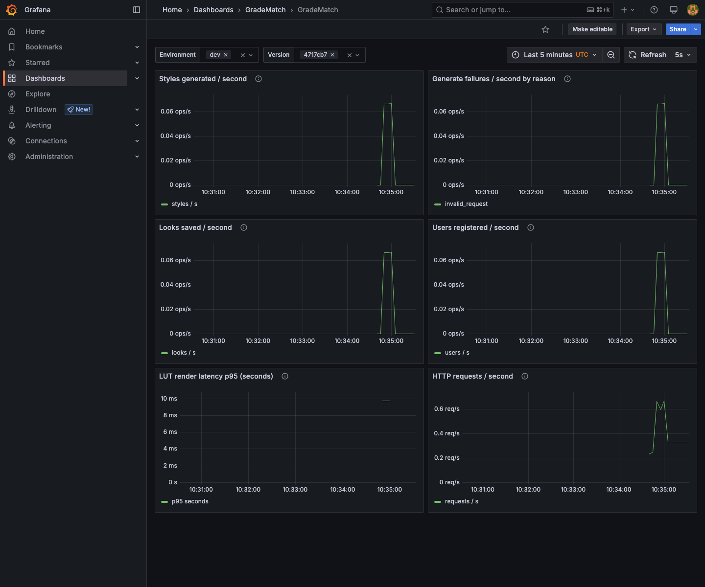

Dev-only filter `dev` / `4717cb7`, six populated panels around 10:35 UTC.


Prod-only filter `prod` / `a3ce833`, six populated panels in the same interval.

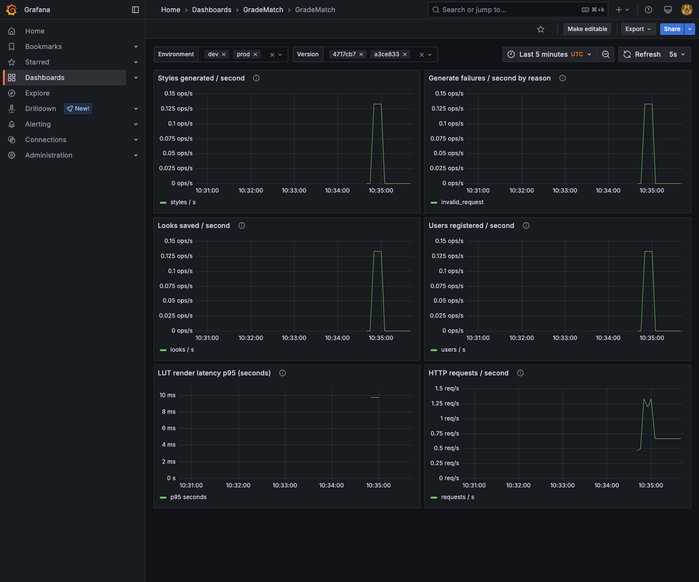

Both environments and supplied versions selected, six populated panels.
[Sanitized query and correlation results](img/obs-demo-evidence.json) record the
2026-11-15 local demo, matching metric labels, request logs and trace resources.
These are local synthetic instances, not live Render telemetry evidence.

### Owner dashboard and API evidence follow-up (2026-11-15)

The Engineer inspected these owner-provided screenshots for readability and
visible secrets before committing. Hook text remains masked; no credentials,
connection strings or private emails are visible.

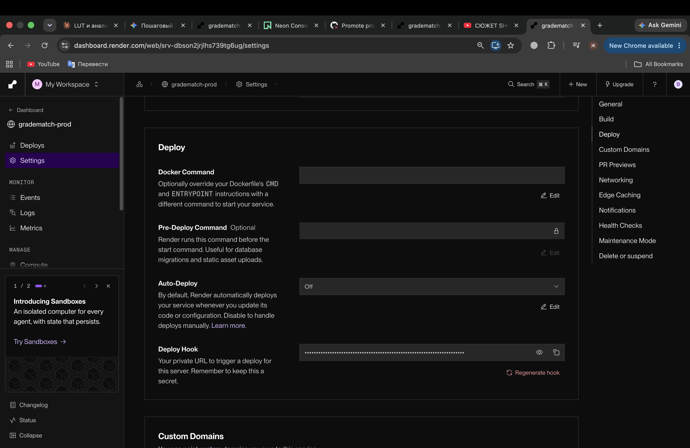

Production service `srv-dbson2jrjlhs739tg6ug` shows Auto-Deploy **Off**.
This screenshot does not show every service setting or database configuration.

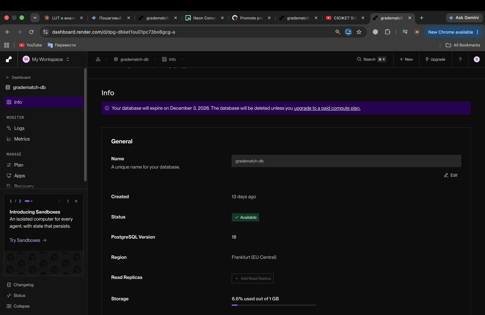

Dev database `gradematch-db` is Available in Frankfurt and its actual notice
states **December 3, 2026**. This replaces the earlier estimated expiry.

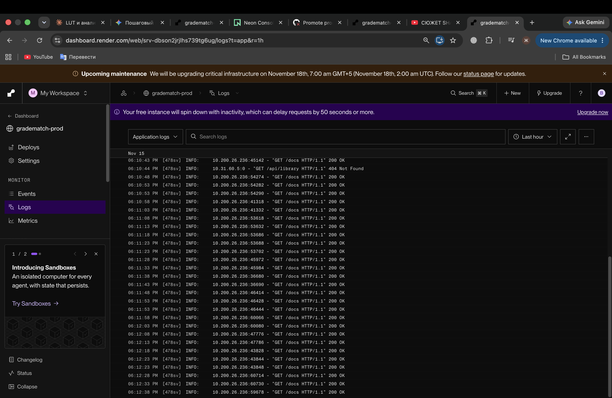

The dashboard banner corroborates prod is a Free instance.
Prod logs show `GET /docs` 200 and a `GET /api/library` 404. The Library API
is `/api/looks`; that 404 does not verify saved-look isolation. The screenshot's
Nov 15 local clock has no explicit timezone. These ordinary request lines do
not expose OpenTelemetry environment/version resources, trace identity or
business metric labels; cloud telemetry acceptance is still unverified.

Owner-supplied Render API deployment metadata (UTC; not independently fetched
by this Engineer):

| Environment | Deploy ID / trigger / status | Commit | Created UTC | Finished UTC |
| --- | --- | --- | --- | --- |
| Dev | `dep-dbsqrhc9v7es73c7ci2g` / `new_commit` / `live` | `591f8b0181d5232c38cead26d711e2d93a69b96a` | `2026-11-15T13:04:05.519984Z` | `2026-11-15T13:05:09.4806Z` |
| Prod | `dep-dbsplf6k1f9s739uls1g` / `deploy_hook` / `live` | `85c7655c25335235844cb0aa7e202b9a0d69affa` | `2026-11-15T11:42:52.649429Z` | `2026-11-15T11:43:55.709203Z` |

[Dev CI 43716607781](https://github.com/bakhytuly07-source/gradematch/actions/runs/43716607781)
for full SHA `591f8b0181d5232c38cead26d711e2d93a69b96a` completed
successfully at `2026-11-15T13:04:02Z`; the supplied matching Render event begins
3.519984 seconds later. This supports the successful exact-SHA gate timeline,
with Render timestamps attributed to the owner. Prod metadata corresponds to
the independently checked promotion evidence above and implies version
`85c7655`; dev implies `591f8b0`. Deployment metadata alone does not prove
emitted cloud telemetry has those version labels.

### Controlled CI gate experiment status

| Phase | Timestamp / interval UTC | Result |
| --- | --- | --- |
| Baseline | Owner API event `2026-11-15T13:04:05.519984Z`–`13:05:09.4806Z` | Dev `591f8b0` live after successful CI, as supplied above |
| Access preflight | 2026-11-15 Engineer session | No Render API credential available in task environment or supported connector; native Chrome access stalled then was aborted |
| Controlled pending / failure | Not run | No failing commit was created or pushed; no no-deploy or retained-live-SHA claim |
| Recovery | Not applicable | Main retains its passing assertions; no failure to revert |

The experiment is authorized but blocked on usable private Render read access.
Supply `RENDER_API_KEY` privately in the task environment or an accessible
authenticated dashboard; never put it in an issue, document or chat. Read access
must produce timestamped deployment-list snapshots before, during pending CI,
after terminal failure and after recovery. A successful baseline does not
replace this experiment. Existing tests and workflow checks were not changed.

### Evidence still required for full acceptance

Still unresolved: historical before/after dev and database identities; complete
live service settings; independently corroborated Neon configuration/migration
logs; controlled pending/failed/recovery event history; cloud request-log,
trace and metric environment/version identity matching actual deployments.
Actual expiry and prod auto-deploy Off are now supported by owner screenshots.
Reciprocal authentication and saved-Library results are recorded separately
below when independently observed. Full #137/#138/#140/#141 acceptance remains
for QA; no unobserved criterion is called passed.

### Independent live reciprocal authentication and Library check

Fresh QA ran the complete two-environment flow at
`2026-11-15T13:27:30.589206+00:00` against the actual public URLs above.
[Sanitized live outputs](img/live-isolation-evidence.json) contain only statuses,
booleans and contract errors; credentials and private email addresses remained
in memory. This is independent QA evidence, not an Engineer replay.

| Disposable account / saved look | Own environment | Other environment |
| --- | --- | --- |
| Dev-only account | Register 201; login 200 | Prod login 401, `auth`: `Email or password is incorrect.` |
| Prod-only account | Register 201; login 200 | Dev login 401, same contract error |
| Look saved on dev | Save 201; own Library contains it | Prod Library absent; direct look GET 404, `not_found`: `Look was not found.` |
| Look saved on prod | Save 201; own Library contains it | Dev Library absent; direct look GET 404, same contract error |

Both synthetic looks were deleted (204) and both sessions logged out. Accounts
were fresh and distinct; failed cross-logins did not register an account.
An earlier QA attempt observed a transient prod cross-login 500 with
`unknown`: `Unexpected processing or server failure.`; a bounded retry first
confirmed prod unknown login 401 and registration 201 at `13:27:19Z`, then
repeated the complete flow successfully as above. The transient failure is
retained as an operational observation, not erased by the passing retry.
Owner-reported successful reverse authentication and repaired Neon migrations
are consistent with the successful retry, but no independent migration log or
private database configuration was available to this Engineer.

This docs-only follow-up reuses the exact implementation test evidence above
(backend 224 passed/1 skipped, frontend 52, integration 10 and existing E2E
scenarios plus 30 Playwright tests). No dependencies, API contract, application
code, workflow checks or test assertions changed.
