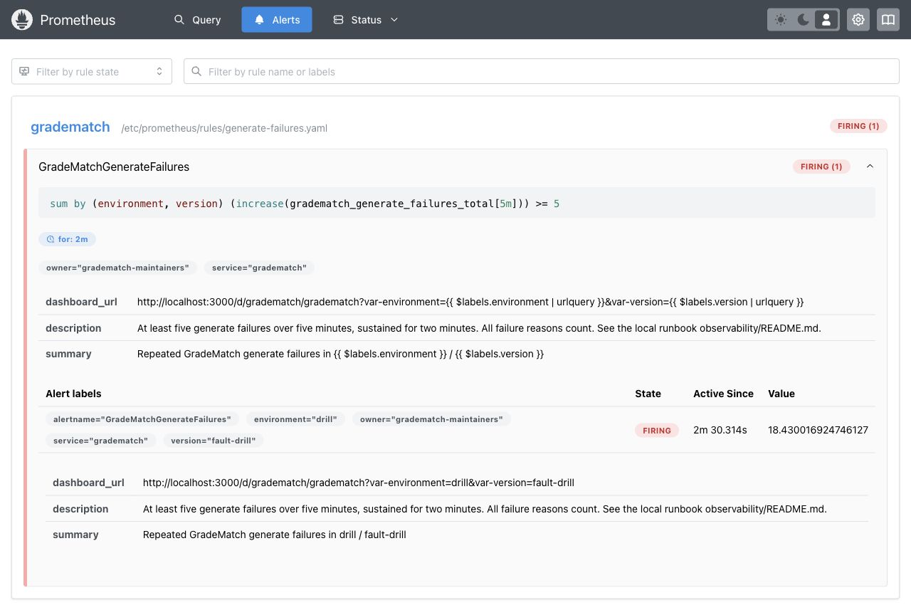

# Initial real fault drill — 2026-11-14

**FAIL (#135): no agent fix commit.** This is actual local execution, not a fixture. #134 passed its independent acceptance checks. No Render deployment, branch push, or merge occurred.

## Baseline and isolation

At 07:57:45Z main was clean at `3831548975860ece89bf77350f5f26036e4c46a3`.
QA created `/tmp/gradematch-fault-20261114` on `inject-bug-2026-11-14`, and committed only the unconditional generation exception as `cbd0f72f68549c6c273ab75f3ae90fd61bd38cad`.

```sh
git log --oneline main..inject-bug-2026-11-14
git diff 3831548975860ece89bf77350f5f26036e4c46a3...inject-bug-2026-11-14 -- backend/app/main.py
git show cbd0f72f68549c6c273ab75f3ae90fd61bd38cad
```

Observed diff: one added `raise RuntimeError("Local drill: injected generation defect")` in `generate_image`. At 08:05:08.974371Z `git rev-parse main` still returned the identical baseline; `git merge-base --is-ancestor cbd0f72 main` returned1. Fault and correction never entered main. This later evidence commit is separate from that proof.

## Real traffic, alert, screenshot

Faulty app: localhost8092, telemetry endpoint localhost4318, environment `drill`, version `fault-drill`, disposable SQLite database. Valid checked-in image sent in memory: before check HTTP500 at07:58:07.918583Z. Baseline failure07:58:07.970302Z,15s settle, then1 failure/10s until firing08:01:13.158287Z; traffic stopped immediately. Processing-error counter was observed in actual Prometheus.



Screenshot captured approximately08:01:40Z from actual localhost9090/alerts, showing FIRING and Active Since2m30.314s. API evidence for the same alert:

```json
{"activeAt":"2026-11-14T07:59:08.695879708Z","labels":{"alertname":"GradeMatchGenerateFailures","environment":"drill","owner":"gradematch-maintainers","service":"gradematch","version":"fault-drill"},"state":"firing"}
```

## One real agent session and failure

Real dry-run printed identity/planned branch/invocation at08:01:30Z; no session launched. Actual poller launched one agent08:01:34Z, ran until SIGINT08:03:52Z (>two60s intervals), and was restarted with `--once`/same state while the alert remained firing. Exactly one matching `.claim` and one timestamped session log exist after restart; no second session. Deduplication suppresses repeated-identity log lines, so intermediate polls have no timestamped lines; immediate/60s cadence is separately fake-clock tested.

Reviewed sanitized session excerpt (paths shortened here only):

```text
2026-11-14T08:01:34Z base_branch=inject-bug-2026-11-14 base_commit=cbd0f72f68549c6c273ab75f3ae90fd61bd38cad
2026-11-14T08:01:34Z branch=oncall/GradeMatchGenerateFailures-20261114T080134Z
command=codex exec --sandbox workspace-write --add-dir /Users/zhaksylykbakhytuly/gradematch/.git -
2026-11-14T08:02:06Z focused valid-image test reproduces HTTP500 instead of200 (exit1)
2026-11-14T08:02:43.994356Z fatal: Unable to create '.git/worktrees/worktree-8479919c244d21ab45d40b5be363dd18e824ab7a61eb217ab8b654d85f944c10/index.lock': Operation not permitted
2026-11-14T08:02:52Z same check after correction HTTP200 exit0;36 relevant tests passed
2026-11-14T08:02:52Z correction uncommitted; no fix SHA created
2026-11-14T08:02:52.795267Z exit_status=0 local_fix_commit=cbd0f72f68549c6c273ab75f3ae90fd61bd38cad base_commit=cbd0f72f68549c6c273ab75f3ae90fd61bd38cad
```

There is **no FIX_SHA** and therefore no truthful `git show FIX_SHA` proof. Agent left only the verified one-line removal uncommitted on its oncall branch; QA did not commit it manually. Inspect:

```sh
git -C on-call-engineer/logs/worktree-8479919c244d21ab45d40b5be363dd18e824ab7a61eb217ab8b654d85f944c10 diff -- backend/app/main.py
```

Local-only raw log: `on-call-engineer/logs/20261114T080134Z-8479919c244d21ab45d40b5be363dd18e824ab7a61eb217ab8b654d85f944c10.log`; API files `alerts-firing.json`, `alerts-resolved.json`, traffic/operator times `drill-evidence.txt`, restart output `drill-poller-restart.txt` in the same ignored directory. `git check-ignore` returned0 for real log. Raw logs/claims/worktree remain ignored and were not published; this excerpt contains no credentials/image bytes/payloads.

## Real correction check and resolution

Stopped faulty server and started agent's uncommitted oncall correction with the same local identity. Valid-image check returned HTTP200 at08:04:08.191575Z. No more failure requests sent. Alert still firing08:05:28.311466Z; observed no matching alert/API resolution08:05:38.321532Z (265.163s after observed firing). Saved API response has empty alerts. Both local drill server and poller stopped. Ordinary Compose app telemetry remains off.

## Independent tests and verdict

Original tools:13PASS. Expanded QA suite:22PASS (original13,new acceptance check and inherited regression reruns). Backend:222PASS/1skip. Integration:10PASS. Frontend:52PASS. E2E:30PASS plus runner scenarios. First restricted backend run had2 socket-binding setup errors; permission-enabled full rerun passed. Agent's own full suite had the same sandbox binding limitation;36 focused related tests passed.

#134:PASS, closed. #135:FAIL/open because criterion5 requires an actual agent-created fix commit; criterion7 cannot link a nonexistent fix SHA. One Engineer fix round requested on main launcher/runbook permissions only. Main production code untouched by QA; fault injection only isolated dated branch.
