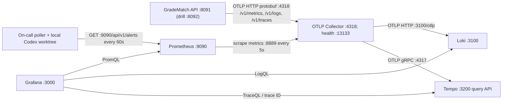
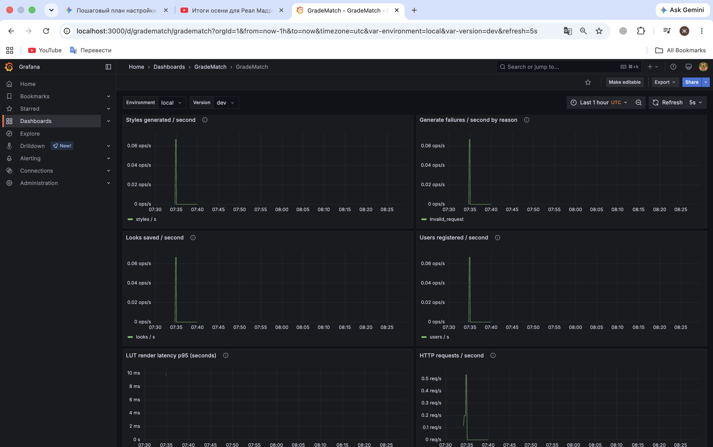
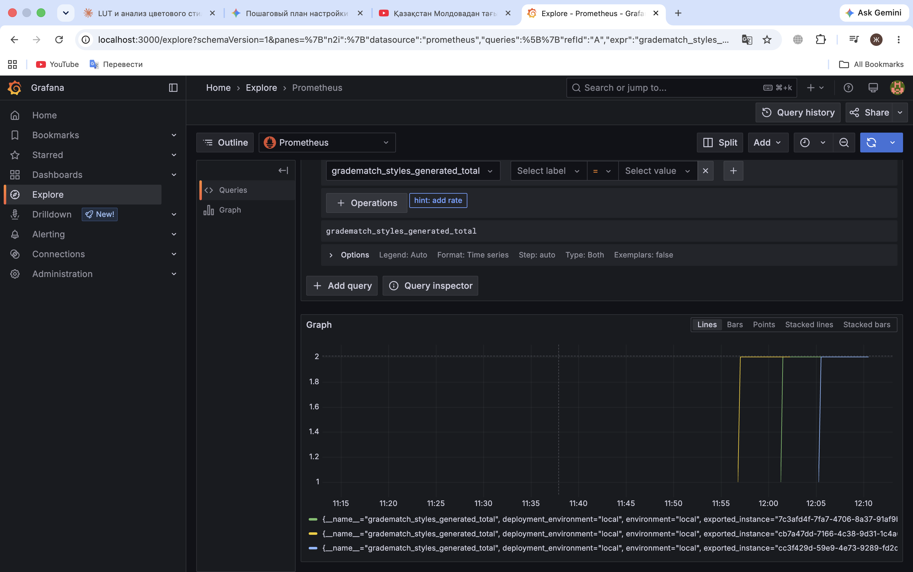
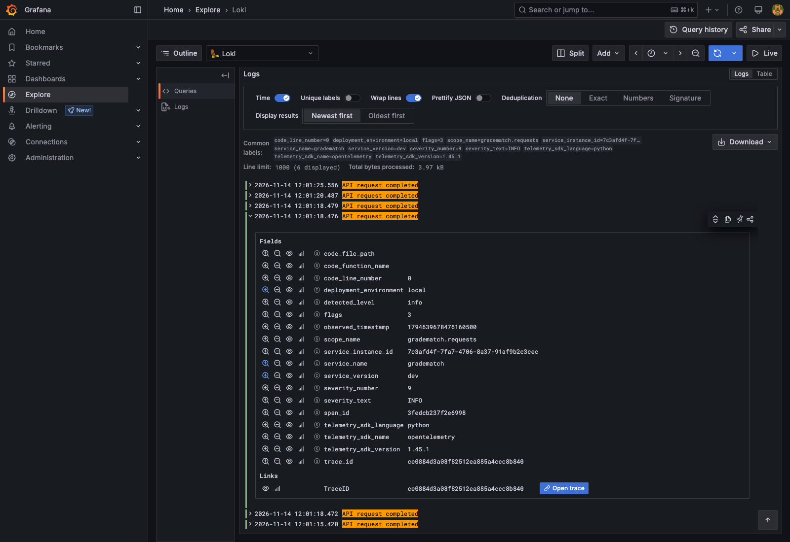
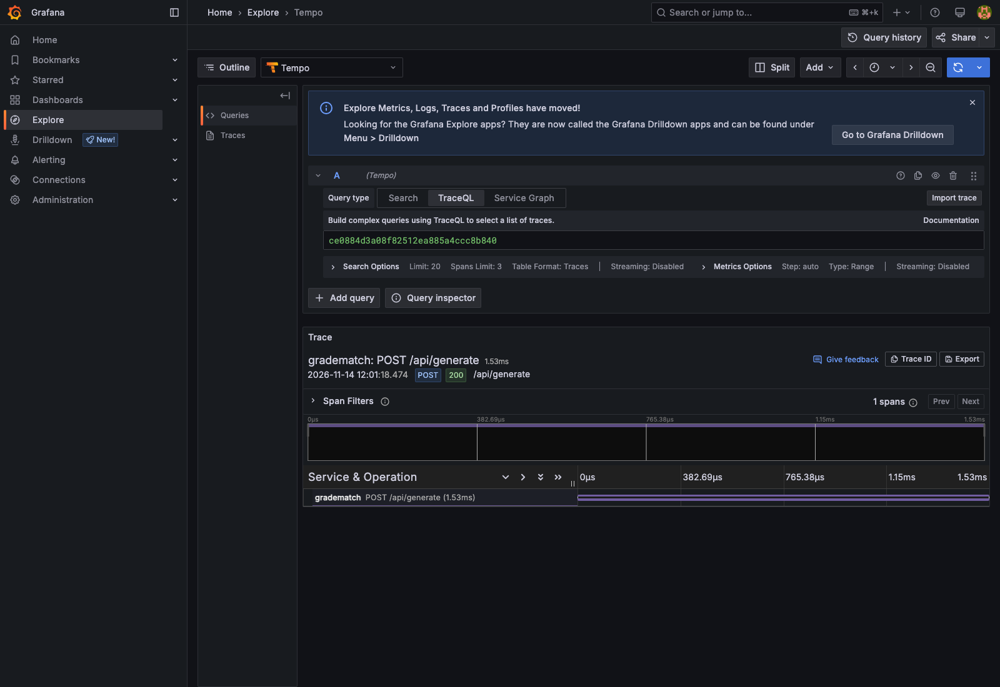
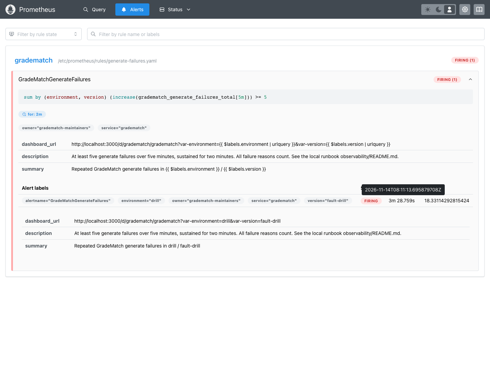

# Local observability runbook

This local development workflow connects GradeMatch's opt-in telemetry to metrics,
logs and traces, then investigates a firing alert without pushing a fix.
The application and observability stacks start and stop independently. No new
Render variables are required. Use disposable accounts and the checked-in test
fixture; uploaded originals remain in memory.

## Architecture



Only host ports 3000, 9090, 3100, 3200, 4318 and 13133 are published, bound to
localhost by default. Collector 8889 and Tempo ingest 4317/4318 are internal.
The native Linux OTLP gateway exception is below. Configurations are in
[Compose](../observability/docker-compose.yaml), [Collector](../observability/collector.yaml),
[Prometheus](../observability/prometheus.yaml), [Loki](../observability/loki.yaml),
and [Tempo](../observability/tempo.yaml).

## Start, connect and stop

Prerequisites: Git, Docker running with Compose v2, Make, curl, Python 3.12 and uv.
A separate frontend dev server also needs Node 22.12+ and npm. The on-call drill
needs an installed/authenticated Codex CLI supporting named permission profiles
(`codex login`, `codex exec --help`). Use the existing lockfiles; no new packages
are needed for the evidence scripts (standard-library Python).

| Component | Pinned image |
| --- | --- |
| Collector | `otel/opentelemetry-collector-contrib:0.123.0` |
| Prometheus | `prom/prometheus:v3.2.1` |
| Loki | `grafana/loki:3.4.2` |
| Tempo | `grafana/tempo:2.7.2` |
| Grafana | `grafana/grafana:11.6.0` |

From the repository root:

```sh
make obs-up
python3 observability/check.py
# Expected: five ready services, three healthy provisioned sources, six-panel dashboard.
docker compose -f observability/docker-compose.yaml ps
```

Open [Grafana](http://localhost:3000), initially `admin` / `admin`; change the
password when prompted. `check.py` accepts `GRAFANA_PASSWORD` after a change.
Allow 90s for warmup; initial Loki/Tempo 503s can be normal. Connections → Data
sources contains provisioned Prometheus, Loki and Tempo. Port conflicts: inspect
`lsof -nP -iTCP:3000 -sTCP:LISTEN` (substitute the affected port).

| App variable | Default / behavior |
| --- | --- |
| `OTEL_EXPORTER_OTLP_ENDPOINT` | Unset or empty disables telemetry; nonempty is an OTLP HTTP base URL, without `/v1/*` suffix |
| `DEPLOYMENT_ENVIRONMENT` | `local`; resource `deployment.environment`, business label `environment` |
| `APP_VERSION` | `dev`; resource `service.version`, business label `version`; image build arg supported |

Resource `service.name` is always `gradematch`. Docker Desktop app startup:

```sh
OTEL_EXPORTER_OTLP_ENDPOINT=http://host.docker.internal:4318 docker compose up -d --build --wait app
# Reconfigure an existing app explicitly:
OTEL_EXPORTER_OTLP_ENDPOINT=http://host.docker.internal:4318 docker compose up -d --force-recreate --wait app
# Example independently versioned image:
docker build --build-arg APP_VERSION=local-review -t gradematch-app:local-review .
```

The root [app Compose](../docker-compose.yaml) supplies
`extra_hosts: host.docker.internal:host-gateway` (Docker Engine 20.10+). On native
Linux a container cannot reach a loopback-only host listener. Publish OTLP on the
private bridge gateway, repeating this prefix on each obs-up:

```sh
OBS_OTLP_BIND_ADDRESS=$(docker network inspect bridge --format '{{(index .IPAM.Config 0).Gateway}}') make obs-up
```

Keep Docker Desktop's default loopback binding. Verify from the app:

```sh
docker compose exec -T app python -c "import socket,urllib.request; print(socket.gethostbyname('host.docker.internal')); r=urllib.request.urlopen(urllib.request.Request('http://host.docker.internal:4318/v1/traces',data=b'',headers={'Content-Type':'application/x-protobuf'}),timeout=3); print(r.status)"
# Expected gateway IP, HTTP 200.
```

Alternatively start the API independently, from `backend/`:

```sh
uv sync --locked --python 3.12
uv run alembic upgrade head
OTEL_EXPORTER_OTLP_ENDPOINT=http://localhost:4318 DEPLOYMENT_ENVIRONMENT=local APP_VERSION=dev uv run uvicorn app.main:app --reload --port 8091
```

In another terminal, from `frontend/`:

```sh
npm ci
VITE_API_URL=http://localhost:8091 npm run dev -- --port 5173 --strictPort
```

Open http://localhost:5173 (or the Docker app at http://localhost:8091). Do not run
the native API and Docker app on 8091 simultaneously.

```sh
make obs-down
# App remains running; observability volumes persist.
make obs-up
# Restore normal app telemetry-off configuration:
OTEL_EXPORTER_OTLP_ENDPOINT= docker compose up -d --force-recreate --wait app
```

Prometheus defaults to 15-day retention (no override); Tempo trace blocks expire
after 24 hours. Loki has no configured automatic retention; Grafana state and
all signal data persist in named volumes. To delete only observability data:
`docker compose -f observability/docker-compose.yaml down -v`. This is a clean
observability start next time; it does not delete the app database. App
`docker compose down -v` separately deletes all app accounts/looks. Use a fresh
independent clone/project for a disposable database if existing data matters.

## Metric contract and copyable queries

[Instrumentation contract](../backend/TELEMETRY.md). Counters count completed
successful operations only, after processing/commit. Failure counts record each
rejected generate handler once. Exported business labels are `environment` and
`version`, plus `reason` on failures. Collector resource conversion also adds
`service_name`, `deployment_environment`, `service_version` and instance identity;
Prometheus adds scrape `job`/`instance` (collisions may be `exported_*`). Never
select an unstable instance ID for the normal dashboard.

| Prometheus series | Type | Units | Instrument-specific labels |
| --- | --- | --- | --- |
| `gradematch_styles_generated_total` | counter | styles | environment, version |
| `gradematch_generate_failures_total` | counter | failed requests | environment, version, reason |
| `gradematch_looks_saved_total` | counter | saved looks | environment, version |
| `gradematch_users_registered_total` | counter | registered users | environment, version |
| `gradematch_lut_render_seconds_bucket`, `_sum`, `_count` | histogram | seconds; count of successful renders | environment, version; bucket adds le |
| `gradematch_http_requests_total` | counter | HTTP requests | http_route, http_response_status_code; resource identity as above |

The histogram family prefix for `_sum` and `_count` is also
`gradematch_lut_render_seconds`. Buckets (seconds): 0.001, 0.005, 0.01, 0.025,
0.05, 0.1, 0.25, 0.5, 1, 2, 5, +Inf. Timing includes successful LUT construction
and response dictionary/list conversion, excluding validation, JSON serialization
and network. Failure `reason` is limited to `invalid_request` (missing/malformed
multipart), `too_large` (byte limit), `invalid_image` (format/decode),
`processing_error` (unexpected processing exception). No filenames, users,
exception texts or images enter labels.

Run these in Prometheus at http://localhost:9090/query or Grafana Explore →
Prometheus → Code. Use the scenario's absolute time window; current queries may
be empty after the app stops exporting.

```promql
sum(gradematch_styles_generated_total{environment="local",version="dev"})
sum(gradematch_looks_saved_total{environment="local",version="dev"})
sum(gradematch_users_registered_total{environment="local",version="dev"})
sum by (reason) (rate(gradematch_generate_failures_total{environment="local",version="dev"}[5m]))
histogram_quantile(0.95, sum by (le) (rate(gradematch_lut_render_seconds_bucket{environment="local",version="dev"}[5m])))
sum(rate(gradematch_http_requests_total{service_name="gradematch",deployment_environment="local",service_version="dev"}[5m]))
```

## Register → generate → save, then correlate

With the opted-in app on 8091, run from the root:

```sh
python3 observability/smoke.py | tee /tmp/gradematch-observability-smoke.txt
```

This is the exact executable journey: registers a unique disposable account
(201), sends checked-in `e2e/fixtures/reference-warm.jpg` as multipart
`referenceFile` to `/api/generate` (200), then saves its returned `styleParams`
with neutral adjustments, blank thumbnail and in-memory bearer token to
`/api/looks` (201). A baseline journey, 12s settling and a second journey let it
assert all three counter increments even on an empty stack. It polls up to 90s
for exports/scrapes, prints safe timestamps/IDs and verifies a matching log/trace.
Two users/looks remain in the local DB. Tokens and image contents are never
printed or written by the script.

```sh
curl --fail --get http://localhost:9090/api/v1/query --data-urlencode 'query=gradematch_styles_generated_total{environment="local",version="dev"}'
```

In Grafana Explore → Loki set an absolute UTC window covering printed scenario
start/end (extend by a few seconds), then run:

```logql
{service_name="gradematch",deployment_environment="local",service_version="dev"} |= "API request completed"
```

Expand the generate completion log, read `trace_id`, then **Open trace**. The
provisioned derived link opens the same Tempo trace. In Tempo → TraceQL, paste
the ID directly, or search in the same window:

```traceql
{ resource.service.name = "gradematch" && resource.deployment.environment = "local" && resource.service.version = "dev" && name = "POST /api/generate" }
```

API equivalents (replace placeholders with smoke output):

```sh
curl --fail --get http://localhost:3100/loki/api/v1/query_range \
  --data-urlencode 'query={service_name="gradematch",deployment_environment="local",service_version="dev"} |= "API request completed"' \
  --data-urlencode 'start=START_NS' --data-urlencode 'end=END_NS' --data-urlencode 'limit=100'
curl --fail http://localhost:3200/api/traces/TRACE_ID
```

Expected: nonempty logs with identity and nonzero trace ID, Tempo HTTP 200 with
the identical ID, `POST /api/generate`, status 200 and all three resource fields.
For a concrete recorded example, use UTC **2026-11-14 07:01:15–07:01:30**,
start `1794639678274786000`, end `1794639686519798000`, ID
`ce0884d3a08f82512ea885a4ccc8b840`. Historical evidence expires with retention;
a new smoke run prints replacement IDs/windows. The captured Explore browser
used Asia/Almaty time: 12:01:18.476 is 07:01:18.476 UTC.

## Provisioned dashboard and five evidence views

Open [GradeMatch dashboard](http://localhost:3000/d/gradematch/gradematch).
The [file provider](../observability/grafana/provisioning/dashboards/dashboards.yaml)
automatically loads [dashboard JSON](../observability/grafana/dashboards/gradematch.json)
on a clean volume. UID `gradematch` persists across restarts. Environment and
Version are single-select, dependent variables. Select local/dev; default Last
15 minutes refreshes every 5s. Use an absolute historical window when reviewing
older traffic. All six panels filter both selected values:

| Panel | Interpretation |
| --- | --- |
| Styles generated / second | successful generation rate |
| Generate failures / second by reason | finite failure categories |
| Looks saved / second | authenticated successful save rate |
| Users registered / second | successful registration rate |
| LUT render latency p95 (seconds) | histogram p95, displayed with suitable time unit |
| HTTP requests / second | all HTTP requests, resource identity selectors |

`python3 observability/dashboard_smoke.py` populates every panel with two
register/generate/save/render journeys and two missing-upload 422s, 15s apart.
It checks the six exact panel expressions. Allow up to 90s. Rates need two
samples; no matching traffic shows “No matching traffic”; an unobserved p95 is
undefined. Dashboard `$__rate_interval` adapts to scrape resolution.

The five views below are actual local system captures, without credentials,
tokens or personal image contents. Existing dashboard/metric captures were
provided in the working tree and visually checked; their browser clock is
local time except the dashboard's explicitly selected UTC display. New log and
trace captures were taken from real Grafana Explore during #136, following the
retained #131 scenario, without modifying the displayed data.

1. Populated six-panel local/dev dashboard (UTC ~07:35 traffic):

   

2. Prometheus business metric and actual result in Grafana Explore:

   

3. Expanded Loki request log, matching trace ID visible:

   

4. Exact same trace in Tempo, generate HTTP 200:

   

5. Real successful-rerun firing alert, required labels and activeAt tooltip:

   

## Alert and API state checks

The [provisioned rule](../observability/rules/generate-failures.yaml) is exactly:

```promql
sum by (environment, version) (increase(gradematch_generate_failures_total[5m])) >= 5
```

`for: 2m`, evaluated every 5s. Five failures in five minutes indicates repeated
impact; the hold avoids isolated spikes. All four failure reasons count, so
invalid client traffic can fire on a healthy server. Fewer than five failures
can miss substantial low-traffic impact; this is not an availability/error-ratio
SLO. Labels: `alertname=GradeMatchGenerateFailures`, affected `environment` and
`version`, `owner=gradematch-maintainers`, `service=gradematch`. The annotation
`dashboard_url` is
`http://localhost:3000/d/gradematch/gradematch?var-environment=ENV&var-version=VERSION`.
No external notification receiver is configured.

```sh
curl --fail http://localhost:9090/api/v1/rules
# Poll during traffic; data.alerts[].state becomes pending, then firing:
curl --fail http://localhost:9090/api/v1/alerts
python3 observability/alert_smoke.py --environment local --version dev
# After traffic stops, repeat this: the matching labels disappear on resolution.
curl --fail http://localhost:9090/api/v1/alerts
```

The script checks no prior matching alert, sends a baseline 422, waits 15s, then
one missing-upload 422 every 10s until firing (240s bound after baseline wait).
It prints pending/firing transitions and exact labels/activeAt, stops traffic,
and waits up to 360s for no matching alert. Other groups may remain in the API;
filter by complete environment/version. No new failures may target that group
during resolution. Rule health, Collector connectivity and resource identity
are first checks for a timeout. Promtool checks are in the
[stack runbook](../observability/README.md#repeated-generate-failure-alert-133).

## On-call operation and safe fault reproduction

[Complete launcher setup and safety](../on-call-engineer/README.md).

```sh
python3 -m unittest discover -s on-call-engineer/tests -v
python3 on-call-engineer/poller.py --dry-run --once
python3 on-call-engineer/poller.py
```

Immediate polling then every 60s, 10s API timeout. Only firing alerts launch an
investigation; workers run alongside polling. Persist ignored
`on-call-engineer/logs/` across restarts. A SHA256 claim of sorted complete labels
plus `activeAt` is written before launch, giving one run per identity even after
restart/failure. Changed labels/start time form a new identity. `--state` can
select one absolute shared directory. Dry run creates no state, process or branch.
Actual worktrees branch from committed `--repo` HEAD as
`oncall/<sanitized-alert>-<UTC>` with numeric collision suffixes. Dirty source
files stay untouched. Ctrl-C stops polling and waits for workers.

Neither launcher nor agent pushes; a rejecting pre-push hook adds a local
safeguard. Review/test the local commit before any manual integration. This is
not a boundary against a malicious agent overriding Git settings. Raw session
logs are ignored and must not be published. Review redaction manually before
sharing a small excerpt. Failed launches remain claimed: inspect the log, fix
CLI authentication/profile/worktree permissions or connectivity, then remove
only that failed identity's claim to retry. Never clear state during active work.
`local_fix_commit=none` / `no_new_commit` is failure evidence, even with exit 0.

For a fresh isolated drill, preserve source main and use a separate clone:

```sh
SOURCE=$PWD
CLONE=/tmp/gradematch-drill-review
FAULT=/tmp/gradematch-drill-review-fault
BASE=$(git rev-parse main)
git clone --no-hardlinks --single-branch --branch main "$SOURCE" "$CLONE"
git -C "$CLONE" worktree add -b inject-bug-$(date -u +%F) "$FAULT" main
```

In the fault checkout only, add
`raise RuntimeError("Local drill: injected generation defect")` at the start of
`generate_image` in `backend/app/main.py`, commit it, and record `INJECT_SHA`.
Install the existing locked backend environment with `uv sync --locked`; migrate
a disposable SQLite database using the same absolute `DATABASE_URL` for Alembic
and the API. Start the faulty checkout's API on 8092 with
`OTEL_EXPORTER_OTLP_ENDPOINT=http://localhost:4318 DEPLOYMENT_ENVIRONMENT=drill APP_VERSION=fault-drill`.
For example, in a separate terminal (after setting `FAULT` as above):

```sh
cd "$FAULT/backend"
uv sync --locked --python 3.12
export DATABASE_URL="sqlite:////tmp/gradematch-drill-review.db"
uv run alembic upgrade head
OTEL_EXPORTER_OTLP_ENDPOINT=http://localhost:4318 DEPLOYMENT_ENVIRONMENT=drill APP_VERSION=fault-drill uv run uvicorn app.main:app --port 8092
```

Use a new disposable DB path for each independent run. From the source root,
use a valid multipart upload (a missing upload cannot reach the injected defect):

```sh
curl -s -o /dev/null -w '%{http_code}\n' -F referenceFile=@e2e/fixtures/reference-warm.jpg http://localhost:8092/api/generate
```

Expected 500. Send a baseline, wait 15s, then repeat one valid-upload request
every 10s until `/api/v1/alerts` shows firing drill/fault-drill; stop traffic.
Run the dry run then real poller with `--repo "$FAULT"` and one shared absolute
`--state "$CLONE/on-call-engineer/logs"`. Exact launch commands, from the source root:

```sh
python3 on-call-engineer/poller.py --repo "$FAULT" --state "$CLONE/on-call-engineer/logs" --dry-run --once
python3 on-call-engineer/poller.py --repo "$FAULT" --state "$CLONE/on-call-engineer/logs"
# After Ctrl-C, while the same alert is firing:
python3 on-call-engineer/poller.py --repo "$FAULT" --state "$CLONE/on-call-engineer/logs" --once
```

Keep it through two 60s polls, stop,
then restart `--once` with the same state while firing. Expect exactly one claim
and one session, an agent-created descendant fix on its assigned oncall branch,
and tests demonstrating valid upload 500 → 200. Inspect `git show FIX_SHA` and
the diff before starting that fixed worktree on 8092 with identical DB/identity.
A valid upload should return 200; send no more failures and wait for resolution.
If the installed CLI cannot commit under its scoped profile, preserve FAIL and
resolve its permissions rather than inventing a fix SHA.

Before/after, record these proofs (ancestry must exit **1**):

```sh
git -C "$SOURCE" rev-parse main
git -C "$CLONE" rev-parse main
# Both must equal recorded BASE until separate documentation commits.
git -C "$CLONE" merge-base --is-ancestor INJECT_SHA main
# Source should not even contain the independent injection object:
git -C "$SOURCE" cat-file -e 'INJECT_SHA^{commit}'
git -C "$CLONE" log --oneline main..inject-bug-$(date -u +%F)
git -C "$CLONE" show FIX_SHA
git -C "$CLONE" diff INJECT_SHA...FIX_SHA -- backend/app/main.py
git -C "$CLONE" branch -r
```

Replace literal SHA placeholders first. Do not push/merge either experimental
branch. Stop drill API/poller; retain ignored local logs for review.

## Timestamped clean-start and drill evidence

[Timestamped stack/scenario validation](../observability/VALIDATION.md) records
actual clean-volume provisioning, readiness, obs-up/down/up and unaffected app
containers. Following the start commands above on empty observability volumes
reproduces it. Record new UTC times (`date -u +%FT%TZ`) and smoke IDs when repeating;
these are historical observed times, not promised future outputs:

| UTC 2026-11-14 | Command / observed outcome |
| --- | --- |
| #130 validation | `make obs-up`, `make obs-down`, `make obs-up`, `python3 observability/check.py`: five services and three sources healthy; existing app/db IDs unchanged |
| 07:01:06 | `python3 observability/smoke.py`: baseline register 201 → generate 200 → save 201 |
| 07:01:18–07:01:26 | second journey 201/200/201; each business counter 3 → 4; Loki/Tempo exact ID match |
| 07:18:42–07:18:59 | `python3 observability/dashboard_smoke.py`: all six local/dev expressions positive |
| 07:23:38 / 07:25:38 / 07:29:59 | `alert_smoke.py --environment qa --version test-build`: pending / firing / resolved |
| 08:09:35 | independent rerun clone named; baseline main `64be0f40f5044b16a5d41299229ec99c69cccbe8` |
| 08:10:14 | valid upload on isolated injected branch: 500 |
| 08:11:13.695879708 | drill alert activeAt (pending begins) |
| 08:13:19.889299 | firing observed; failure traffic stopped |
| 08:13:39 / 08:13:48 | real dry run, then continuous poller launch |
| 08:14:43.921 | actual firing screenshot above |
| 08:14:57 | agent creates local fix commit |
| 08:15:37.767598 | inspected fixed checkout valid upload: 200 |
| 08:16:09 | restart `--once`, still only one claim/session |
| 08:17:47.926747 | matching alert absent (resolved), 268s after traffic stop |

The [initial drill](fault-drill-2026-11-14-initial.md) remains **FAIL**: the agent
corrected code but could not commit, so no fix SHA existed. The
[successful rerun](fault-drill-2026-11-14-rerun.md) after the scoped adapter fix
is the completion proof. Reviewed redacted/shortened excerpt:

```text
08:13:48.299350Z base_branch=inject-bug-2026-11-14 base_commit=09c25c848968aae9483260dbe621b561a20db67f
08:13:48.380973Z branch=oncall/GradeMatchGenerateFailures-20261114T081348Z
08:14:33.098234Z focused valid-image test: 1 failed (500 rather than 200)
08:14:49.498954Z same focused test after correction: 1 passed
08:14:56Z relevant generation/API/extraction/metrics tests: 40 passed
08:15:07.152210Z exit_status=0 investigation_result=local_commit_created
local_fix_commit=3ed5e23fbe22c0bbd2bf5ae0d5c6df6f414d37a8
```

Full ignored log location (never committed):
`/tmp/gradematch-drill-rerun-20261114T080935Z/on-call-engineer/logs/20261114T081348Z-1c853f1502e59533b550b572460998e29f111fe585006b85850f11a996b0b7ce.log`.

```sh
git -C /tmp/gradematch-drill-rerun-20261114T080935Z show 3ed5e23fbe22c0bbd2bf5ae0d5c6df6f414d37a8
git -C /tmp/gradematch-drill-rerun-20261114T080935Z diff 09c25c848968aae9483260dbe621b561a20db67f...3ed5e23fbe22c0bbd2bf5ae0d5c6df6f414d37a8 -- backend/app/main.py
```

These objects exist **only in that independent local repository**. An ordinary
fresh GitHub clone cannot `git show` them. Repeat the isolated drill above to
obtain a new local fix SHA; do not fetch/publish fault branches to make evidence
appear portable. Rerun verification found both main refs unchanged at baseline,
`merge-base --is-ancestor INJECT_SHA main` exit 1, and source lacked the injection
object. Only sanitized documentation/screenshots were later published.

## #136 documentation verification

Actual GitHub rendering was verified on 2026-11-14 at approximately 08:50 UTC
in Chromium on the published `main` document. GitHub's
`viewscreen.githubusercontent.com/markdown/mermaid` iframe contained a visible
`svg#diagram` with `aria-roledescription="flowchart-v2"`, showing all seven
components, signal paths and ports without a parser error. The unmodified
[GitHub rendering screenshot](img/github-mermaid-render.png) records the
repository path, Preview tab, source commit `70f9312` and rendered diagram.

At 2026-11-14 08:42:08 UTC, `python3 observability/check.py` passed all five
readiness checks, three datasource checks and provisioned six-panel dashboard.
Historical Prometheus HTTP series at 07:35:30 UTC confirmed the documented
`http_route` / `http_response_status_code` and resource label names. Current
series were absent because ordinary app telemetry remained off. The historical
Loki record and its derived Tempo link were queried in the actual local UI and
captured for this guide; no traffic or fault was fabricated. The recorded local
fix was independently readable with `git show` (one-line removal).

Local Markdown file/image targets resolve; exactly five required evidence images
are embedded, each visually inspected. `git diff --check` passed. Required full
suites: backend `uv run pytest` **222 passed, 1 optional PostgreSQL skip**, five
existing warnings; frontend `npm test -- --run` **52 passed**. The installed
backend environment used Python 3.14.7 for this check; documented setup remains
Python 3.12. This change introduces documentation/images only, with no new
behavior, packages or contract changes.

## Two-environment demo

Run `make obs-demo` from the repository root for isolated dev/prod instances plus
the existing stack. It waits for health and generates real sample traffic, then
checks populated metrics, correlated logs/traces and environment/version filters.
Use `make obs-demo-down` to remove only demo resources. See
[environments](environments.md#telemetry-identity-and-repeatable-local-demo-140)
for prerequisites, ports, overrides, identity derivation and evidence. The normal
`make obs-up` ports, project and resources remain unchanged by default.
